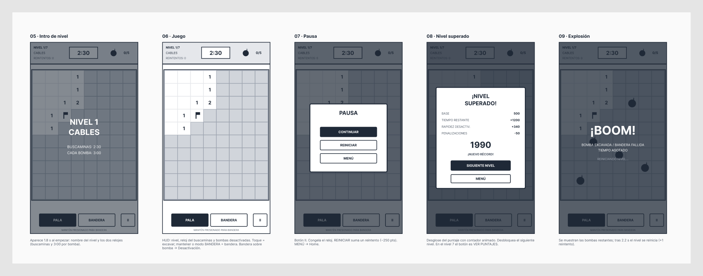

# PIXELMINAS — Desactiva o explota

Buscaminas en pixel art con **modo desactivación de bombas**. Cada nivel esconde 5 bombas. Cuando el jugador pone una bandera sobre una bomba, entra en un mini juego con una cuenta regresiva de **3:00**. Si lo resuelve, la bomba queda desactivada; si no, explota y el nivel se reinicia.

App **híbrida**: Phaser 3 (motor de videojuegos web) + TypeScript + Vite, empaquetada para Android con **Capacitor 8**.

---

## Cómo se juega

| Acción | Resultado |
|---|---|
| Tocar una casilla (modo PALA) | Excava. El primer toque nunca es una bomba. |
| Mantener presionado, clic derecho o modo BANDERA | Pone una bandera. |
| Bandera sobre bomba | Se pausa el reloj del nivel y empieza la **desactivación (3:00)**. |
| Bandera en casilla vacía | Se **resta tiempo** al reloj del nivel y la bandera se retira. |
| Excavar una bomba / fallar la desactivación / acabarse el tiempo del nivel | 💥 Explota y **se reinicia el nivel**. |
| Desactivar las 5 bombas | Nivel superado: se calcula el puntaje y se desbloquea el siguiente. |

Dentro de la desactivación, cada error resta 20 s del cronómetro de 3 min (en el laberinto, 10 s).

## Niveles

Son **20 niveles** en cuatro tramos (definidos en `src/data/levels.ts`). A medida que se avanza, el tablero crece, el reloj del buscaminas se acorta, la bandera falsa resta más tiempo y los mini juegos se vuelven más exigentes. Dentro de un nivel, además, la dificultad sube cada dos bombas.

Hay **dos relojes independientes**:

- **Reloj del buscaminas**: cuenta solo mientras se excava y se ponen banderas. Las banderas falsas le restan tiempo.
- **Reloj de cada mini juego: 3:00 por bomba.** Cada una de las 5 bombas del nivel tiene sus propios 3 minutos completos. Mientras corre, el reloj del buscaminas queda **pausado**.

| Niveles | Tramo | Mini juegos | Tablero | Reloj buscaminas | Bandera falsa |
|---|---|---|---|---|---|
| 1–7 | Básico | Uno por nivel, en este orden: Cables, Interruptores, Eco inverso, Código, Laberinto, Tuberías, Núcleo | 8×10 → 9×12 | 3:00 → 2:45 | −5 s → −12 s |
| 8–14 | Avanzado | Los mismos 7, en versión más difícil ("CABLES II"…) | 9×12 → 10×14 | 2:40 → 2:30 | −14 s → −20 s |
| 15–17 | Mezcla | Varios mini juegos distintos en el mismo nivel | 10×14 | 2:25 → 2:15 | −22 s → −25 s |
| 18–20 | Caos | Un mini juego al azar por bomba; en 19 y 20, todos al máximo | 10×14 | 2:10 → 2:00 | −26 s → −30 s |

**Dificultad de los mini juegos** (escala 0–6, `difficultyFor()` en `levels.ts`: tramo × 2 + una subida cada dos bombas):

| Mini juego | Más fácil (0) | Más difícil (6) |
|---|---|---|
| Cables | 3 cables, 5 reglas | 6 cables y una regla extra (vocal en el serial + cable blanco) |
| Interruptores | 5 palancas (16-8-4-2-1) | 6 palancas (32…1); pantalla roja = máximo − n |
| Eco inverso | Secuencia de 3 luces | Secuencia de 7 luces, más rápida |
| Código | 3 dígitos del 1 al 6 | 4 dígitos del 1 al 8 (7 intentos por ciclo) |
| Laberinto | 5×5, se ve a 3 casillas | 8×8, se ve solo a 1 casilla |
| Tuberías | 4×4 | 6×6 |
| Núcleo | Panel 3×3, 3 toques para resolver | Panel 5×5, 7 toques |

**Puntaje por nivel** = 500 × nivel + 10 × segundos restantes + 2 × segundos sobrantes en cada desactivación − 250 × reintentos − 50 × banderas falsas (mínimo 100).

## Cumplimiento de la rúbrica

| Requisito | Dónde |
|---|---|
| Enfoque híbrido | Phaser (web) + Capacitor → APK/AAB Android |
| Wireframe en escala de grises | [Figma](https://www.figma.com/design/13NCFqUkchjfIDZxMwRnN4) y `docs/wireframes/` |
| Mínimo 3 niveles | 20 niveles en 4 tramos de dificultad (`src/data/levels.ts`) |
| Control de tiempo | Reloj por nivel + 3:00 por bomba |
| 5 secciones | **Splash** (`SplashScene`), **Home** (`HomeScene` + `LevelSelectScene`), **Juego** (`GameScene` + `DefuseScene`), **Puntaje** (`ScoreScene`), **Créditos** (`CreditsScene`) |
| UI personalizada | Pixel art dibujado en código (`src/ui/PixelArt.ts`), paleta Sweetie 16, fuente Press Start 2P, botones propios (`PixelButton`) |
| Persistencia entre vistas | `localStorage` (`src/services/Save.ts`): niveles desbloqueados, récords, historial, ajustes de sonido, huevos encontrados. Estado temporal entre escenas con el `registry` de Phaser. |
| Animaciones | Tweens (rebotes, aparición del tablero en onda, contador de puntaje), partículas (explosiones, chispas, confeti), sacudida de cámara, fundidos entre escenas |
| Sonidos | Efectos 8-bit y música en bucle sintetizados con Web Audio API (`src/services/Sfx.ts`) |
| Bonus: Easter eggs 🪺 | 3 huevos (ver abajo) |
| Publicación Google Play | Proyecto Android en `android/` (targetSdk 36). Pasos más abajo. |

### Easter eggs (¡spoilers!)

1. **Logo**: toca la bomba del Home 7 veces → desbloquea todos los niveles (útil para la demo).
2. **Modo gato**: toca 3 veces el nido 🪺 escondido en la esquina de Créditos, o escribe el código Konami (↑↑↓↓←→←→BA) en el Home con teclado → las bombas se convierten en gatos.
3. **Tiempo secreto**: toca 5 veces rápido el cronómetro del nivel → +15 s (una vez por intento).

El progreso de los huevos se ve en Puntajes.

## Diseño

Wireframes en escala de grises: **[Pixelminas — Wireframes (Figma)](https://www.figma.com/design/13NCFqUkchjfIDZxMwRnN4)**. Son 19 pantallas a 360×640, la misma resolución lógica del juego, repartidas en cinco secciones. Cada pantalla lleva debajo una nota con su comportamiento. Las imágenes exportadas están en `docs/wireframes/`.

| Sección | Pantallas |
|---|---|
| [Mapa de navegación](docs/wireframes/0-mapa-de-navegacion.png) | Cómo se conectan las pantallas |
| [Splash y menú](docs/wireframes/1-splash-y-menu.png) | Splash, Home, Cómo jugar, Selección de nivel |
| [Partida](docs/wireframes/2-partida.png) | Intro de nivel, Juego, Pausa, Nivel superado, Explosión |
| [Desactivación](docs/wireframes/3-desactivacion.png) | Pantalla base y los 7 mini juegos |
| [Puntajes y créditos](docs/wireframes/4-puntajes-y-creditos.png) | Las dos pantallas finales |



## Estructura del código

```
src/
  main.ts                 Configuración de Phaser, carga de fuente, botón atrás de Android
  theme.ts                Resolución (360×640), paleta, helper de texto
  data/levels.ts          Definición de los 20 niveles y la escala de dificultad
  data/credits.ts         Nombres del equipo (¡editar!)
  services/Save.ts        Persistencia (localStorage)
  services/Sfx.ts         Sintetizador de sonidos y música
  ui/PixelArt.ts          Sprites a partir de mapas de caracteres
  ui/PixelButton.ts       Botón y panel pixel art
  ui/fx.ts                Explosiones, confeti, textos flotantes, transiciones
  scenes/                 Boot, Splash, Home, LevelSelect, Game, Defuse, Score, Credits
  minigames/Minigame.ts   Clase base (manual de reglas, éxito, error)
  minigames/*.ts          Un archivo por mini juego
```

**Flujo de la desactivación:** `GameScene` detecta la bandera sobre una bomba, lanza `DefuseScene` encima y se pausa a sí misma (con eso también se detiene su reloj). `DefuseScene` crea el mini juego del nivel y lleva su propia cuenta de 3:00. Al terminar, reanuda `GameScene` y le emite el evento `defuse-result` con `{ success, timeLeft }`.

## Desarrollo

Requisitos: Node 22 o superior.

```bash
npm install
npm run dev        # http://localhost:5173 (usa la vista de móvil del navegador)
npm run build      # genera dist/
```

## Android y Google Play

Requisitos: **Android Studio** (incluye el SDK y un JDK compatible).

```bash
npm run build
npx cap sync android
npx cap open android
```

En Android Studio:

1. **Probar**: conecta un teléfono con depuración USB (o un emulador) y pulsa ▶ Run.
2. **Ícono**: ya está el de PixelMinas (la bomba del juego sobre azul noche) en `android/app/src/main/res/mipmap-*`. Para rehacerlo, clic derecho en `app` → New → Image Asset.
3. **Versión**: en `android/app/build.gradle`, sube `versionCode` en cada subida a Play.
4. **AAB firmado**: Build → Generate Signed App Bundle / APK → Android App Bundle → crea un *keystore* nuevo (**guárdalo junto con su contraseña: sin él no se pueden publicar actualizaciones**; está en `.gitignore`, no lo subas al repo).
5. En **Google Play Console**: crea la app, completa la ficha (descripción, capturas, ícono de 512 px, gráfico de 1024×500), la clasificación de contenido, la política de privacidad (el juego no recoge datos personales) y el formulario de seguridad de datos. Sube el `.aab` a *Prueba interna* o *Producción*.

> Nota: las cuentas personales nuevas de Play Console deben hacer una **prueba cerrada con testers durante 14 días** antes de publicar en producción. Conviene empezar pronto.

## Uso de IA (justificación)

El código se generó con asistencia de **Claude (Anthropic)** a partir del diseño del equipo: la idea del buscaminas con desactivación, los 20 niveles, la regla de reiniciar el nivel y la penalización por bandera falsa. Decisiones técnicas y su porqué:

- **Phaser 3** en lugar de DOM puro: ya trae escenas, tweens, partículas, input táctil y escalado a cualquier pantalla. Así nos enfocamos en la lógica del juego.
- **Sprites y sonidos generados por código**: no hay assets externos con licencias dudosas, el APK pesa menos y el pixel art se edita como texto (`ui/PixelArt.ts`).
- **Bombas colocadas después del primer toque** (`GameScene.generate`): la primera jugada nunca pierde, igual que en el buscaminas clásico.
- **Relleno por inundación con BFS** (`GameScene.dig`): abre las zonas vacías.
- **Generación procedural que garantiza solución**:
  - Laberinto con DFS (siempre tiene camino; la meta es la celda más lejana según BFS).
  - Tuberías: primero se traza un camino válido y después se giran las piezas al azar.
  - “Luces fuera”: se parte del panel apagado y se aplican toques al azar.
- **Escena superpuesta + pausa** para la desactivación: reutiliza la pausa de Phaser para congelar el reloj del nivel sin lógica extra.

Antes de la sustentación, cada integrante debe leer y saber explicar al menos `GameScene.ts`, `DefuseScene.ts`, `Save.ts` y uno de los mini juegos.

## Créditos

- Desarrollo: **Juan Andrés Ciro** y **Juan Manuel Arias**.

- Paleta [Sweetie 16](https://lospec.com/palette-list/sweetie-16) por GrafxKid.
- Fuente Press Start 2P por CodeMan38 (SIL Open Font License).
- Motor: Phaser 3. Empaquetado: Capacitor.
